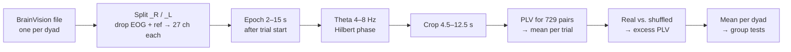
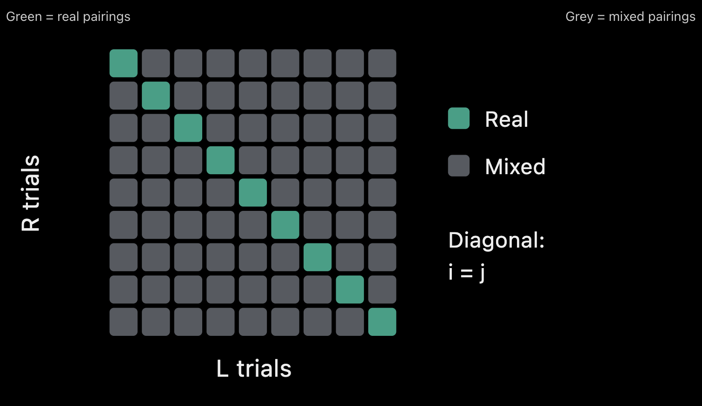
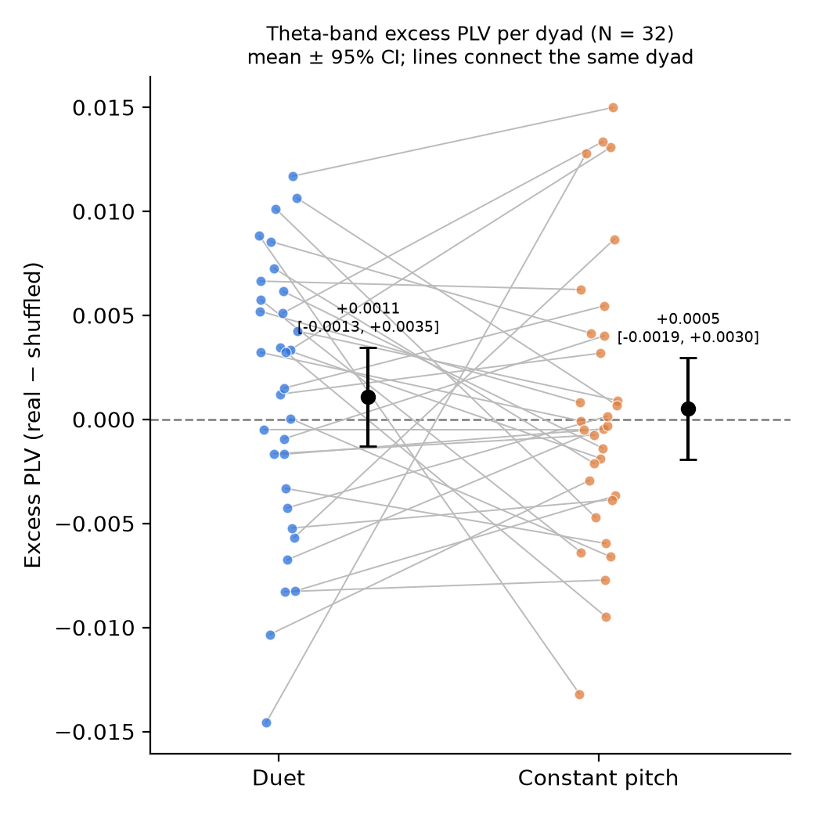

# Exploring Neural Dynamics During Joint Action

## Index

- [Goal](#goal)
- [Methods](#methods)
- [Dataset](#dataset)
- [Preprocessing](#preprocessing)
- [Results](#results)
  - [Synchronization](#synchronization)
  - [Desynchronization](#desynchronization)
- [Proof of Concept Analysis](#proof-of-concept-analysis)
  - [PLV (1 dyad)](#plv-1-dyad)
- [References](#references)
- [Next Steps](#next-steps)

## Goal

When people act together, as when two musicians play a duet, their behaviour becomes closely coordinated in time. Earlier studies have reported inter-brain phase synchrony during social interaction [1] and while playing music together [2, 3].

But Inter-brain synchrony is hard to interpret. Two brains can appear "synchronized" without interacting at all, because both participants hear the same tones, follow the same beat and make similar movements [4]. Common synchrony measures such as PLV are also prone to spurious hyper-connections [4]. On top of that, EEG has low spatial resolution, and playing an instrument introduces motion and muscle artifacts. Comparing every channel of one person with every channel of the other also creates a large multiple-comparison problem. For these reasons, the analysis compares real partner pairs against a shuffled baseline consisting of

Recently, researchers proposed an overlooked counter-effect. They argued that a person's subjective involvement in an interaction raises their neural entropy, which should show up as inter-brain desynchronization (IBD), for example as reduced phase synchrony [5]. On this view, social interaction may push brains toward synchrony, while subjective involvement pulls them apart. In the duets here, each partner plays a different part (melody vs. accompaniment). This makes the task a good test of whether desynchrony, and not only synchrony, tracks how involved participants feel.

This project asks whether inter-brain coupling appears in a musical joint-action task, and whether it relates to the sense of joint agency. In a phenomenological sense, joint agency is the feeling that "we" produced the outcome together.
The main guiding research questions are therefore:

- **Inter-brain synchrony**: Do corresponding trial pairs exhibit greater phase synchrony than non-corresponding pairs?
- **Subjective involvement**: Does the degree of inter-brain synchrony or desynchrony predict how involved participants feel in the joint action?

## Methods

All analyses are exploratory.
Code: [create_epochs.py](create_epochs.py) (epoching), [plv_all-subjects.ipynb](plv_all-subjects.ipynb) (PLV and statistics), [update_readMe.py](update_readMe.py) (writes the result tables into this README).
Process:

### Participants and recordings

Data come from OpenNeuro dataset ds007471 (32 dyads, 64 participants). Each dyad was recorded in one BrainVision file, with channels labelled `_R` or `_L` for the two participants. For each participant, the EOG channels (`VEOG_a`, `VEOG_b`, `HEOG_l`, `HEOG_r`) and the reference channel (`ref_lm`) were removed. That leaves 27 EEG channels per person. Channel positions were assigned from the standard 10–20 montage.

### Trial selection and epoching

- **Practice trials.** Trials before the start of the test phase were excluded. The test phase starts at marker `S1`. In two dyads (sub-03, sub-18) `S1` was missing, so the ninth-to-last `S107` marker was used instead. This removed 2–9 practice trials per dyad.
- **Condition.** Each trial (onset marker `S105`) was labelled with the most recent condition marker before it: `S10` = duet, `S11` = constant pitch.
  - **Duets**: 4 familiar melodies (Twinkle Twinkle Little Star, Hush Little Baby, B.I.N.G.O., Yankee Doodle), split into a melody part and an accompaniment part, one per participant.
  - **Constant-pitch:** 4 monotone control sequences (fixed pitches: A4, C5, E♭5, F♯5), same structure but with no real melodic coordination demand (low-engagement contrast condition).
- **Completeness.** A trial was kept only if all of the markers `S2`, `S3` and `S106` appeared before the next trial onset. Of 55–63 test-phase trials per dyad, 36–40 were kept (1,243 in total; 16–20 duet and 17–20 constant-pitch trials per dyad).

**Preprocessing results are listed here:** [Results CSV file](preprocessing_summary.csv)

### Phase-locking value

Epochs were band-pass filtered to theta (4–8 Hz; MNE's default zero-phase FIR filter). The instantaneous phase φ(t) was taken from the Hilbert analytic signal. Filtering and the Hilbert transform were applied to the full epoch, which was then cropped to 4.5–12.5 s. This keeps filter edge effects out of the analysis window.

For participant R's trial _i_, participant L's trial _j_, and one channel pair (_c_, _d_), PLV is computed across the _T_ samples of the window:

$$\mathrm{PLV}_{ij}(c,d) = \left| \frac{1}{T} \sum_{t=1}^{T} e^{\,i\left[\phi^{R}_{i,c}(t) - \phi^{L}_{j,d}(t)\right]} \right|$$

This value was averaged over all 27 × 27 = 729 channel pairs, including non-homologous pairs. The result is one number per trial combination, stored as a trial × trial matrix _M_ for each dyad:

### Real, shuffled and excess PLV

Within each condition, separately:

- **Real:** for trial _i_ is the diagonal entry *M*ᵢᵢ which is both partners recorded at the same time.
- **Shuffled:** This is the average of the cells you can see on the off-diagonal on the above image. So the baseline keeps the two individuals and the task type the same, and only switches up which trials are being matched.
- **Excess PLV** = real − shuffled.
  The simple (perhaps naive) thought behind this is that we can just get a somewhat accurate measure of the synchronization if we just substract the shuffled PLV, so a kind of "shuffle-corrected PLV". It's based on this paper, but there are also other ways of doing it, I haven't fully explored.

Perkel DH, Gerstein GL, Moore GP. Neuronal spike trains and stochastic point processes. II. Simultaneous spike trains. Biophys J. 1967 Jul;7(4):419-40. doi: 10.1016/S0006-3495(67)86597-4. PMID: 4292792; PMCID: PMC1368069.

### Statistical analysis

- **Excess PLV against zero:** one-sample _t_-test for each condition, with Cohen's _d_ = mean / SD.
- **Duet vs. constant pitch:** paired _t_-tests on excess PLV and on real PLV, with Cohen's *d*z = mean difference / SD of differences.
- **Robustness check:** every _t_-test is paired with a Wilcoxon signed-rank test.
- **Confidence intervals:** 95% CIs come from the _t_ distribution.
- **Significance:** two-sided α = .05. There is no correction for multiple comparisons; the four tests are reported as exploratory.

## Dataset

The dataset used for this is ds007471, an EEG hyperscanning study of the sense of joint agency during a musical joint-action task. The study included 32 pairs of participants (64 people in total), each pair recorded simultaneously on a single 64-channel BrainVision file (32 channels per person, distinguished by `_R`/`_L` suffixes).
Each pair ran through 8 tone sequences (4 duets + 4 constant-pitch) × 5 joint trials each = 40 trials per dyad.

Measured:

- **Joint agency rating (subjective involvement)** (1–7 self-report) after each trial: how much the participant felt their actions and the outcome were jointly theirs.
- **Synchronization performance**: The measured timing asynchrony between the two participants' note onsets, as a proportion of the beat interval, plus its variability (SD) per trial.

## Results

### Synchronization

The plot shows the shuffle-corrected PLV for all 32 dyads and the two condition duet and constant pitch. Since the duet task requires more coordination, we would expect that this condition shows more PLV, but this is not the case.

#### 1. Descriptive statistics

<!-- NB2_DESCRIPTIVE_START -->

| Condition      | Measure                      |   N |   Mean |     SD |    SEM |            95% CI |
| -------------- | ---------------------------- | --: | -----: | -----: | -----: | ----------------: |
| Duet           | Real PLV                     |  32 | 0.1189 | 0.0084 | 0.0015 |  [0.1159, 0.1219] |
| Duet           | Shuffled PLV                 |  32 | 0.1178 | 0.0029 | 0.0005 |  [0.1168, 0.1189] |
| Duet           | Excess PLV (real − shuffled) |  32 | 0.0011 | 0.0066 | 0.0012 | [-0.0013, 0.0035] |
| Constant pitch | Real PLV                     |  32 | 0.1180 | 0.0071 | 0.0012 |  [0.1155, 0.1206] |
| Constant pitch | Shuffled PLV                 |  32 | 0.1175 | 0.0020 | 0.0004 |  [0.1168, 0.1182] |
| Constant pitch | Excess PLV (real − shuffled) |  32 | 0.0005 | 0.0068 | 0.0012 | [-0.0019, 0.0030] |

> **Auto-summary:** Duet: mean excess PLV = 0.0011, 95% CI [-0.0013, 0.0035] (includes zero). Constant pitch: mean excess PLV = 0.0005, 95% CI [-0.0019, 0.0030] (includes zero).

<!-- NB2_DESCRIPTIVE_END -->

**Interpretation:**

#### 2. Excess PLV against zero (one-sample tests)

<!-- NB2_ONE_SAMPLE_START -->

| Condition      | Mean excess PLV |    t |  df |     p | Cohen's d | Wilcoxon W | Wilcoxon p |
| -------------- | --------------: | ---: | --: | ----: | --------: | ---------: | ---------: |
| Duet           |          0.0011 | 0.93 |  31 | 0.359 |      0.16 |      209.0 |      0.313 |
| Constant pitch |          0.0005 | 0.43 |  31 | 0.673 |      0.08 |      262.0 |      0.978 |

> **Auto-summary:** Duet: t(31) = 0.93, p = 0.359 (not significant), d = 0.16 (negligible). Constant pitch: t(31) = 0.43, p = 0.673 (not significant), d = 0.08 (negligible).

<!-- NB2_ONE_SAMPLE_END -->

**Interpretation:**

#### 3. Excess PLV: duet vs. constant pitch (paired)

<!-- NB2_PAIRED_EXCESS_START -->

| Mean difference |            95% CI |    t |  df |     p | Cohen's dz | Wilcoxon W | Wilcoxon p |
| --------------: | ----------------: | ---: | --: | ----: | ---------: | ---------: | ---------: |
|          0.0006 | [-0.0028, 0.0039] | 0.35 |  31 | 0.731 |       0.06 |      244.0 |      0.719 |

> **Auto-summary:** Excess PLV (duet − constant pitch): Δ = 0.0006, 95% CI [-0.0028, 0.0039] (includes zero), t(31) = 0.35, p = 0.731 (not significant), dz = 0.06 (negligible).

<!-- NB2_PAIRED_EXCESS_END -->

**Interpretation:**

#### 4. Real PLV: duet vs. constant pitch (paired)

<!-- NB2_PAIRED_REAL_START -->

| Mean difference |            95% CI |    t |  df |     p | Cohen's dz | Wilcoxon W | Wilcoxon p |
| --------------: | ----------------: | ---: | --: | ----: | ---------: | ---------: | ---------: |
|          0.0009 | [-0.0029, 0.0046] | 0.48 |  31 | 0.634 |       0.08 |      235.0 |      0.599 |

> **Auto-summary:** Real PLV (duet − constant pitch): Δ = 0.0009, 95% CI [-0.0029, 0.0046] (includes zero), t(31) = 0.48, p = 0.634 (not significant), dz = 0.08 (negligible).

<!-- NB2_PAIRED_REAL_END -->

**Interpretation:**

#### Summary

So far there is no evidence that true partners show more theta-band phase synchrony than pseudo-pairs, in either condition, and no evidence that the musical coordination demand changes this. The next steps are to add the joint-agency ratings at the trial level, to compare other frequency bands and measures (CCorr; alpha, beta, gamma) against the same shuffled baseline, and to choose channel subsets in advance.

### Desynchronization

## Proof of Concept Analysis

### PLV (1 dyad)

For each complete trial, theta (4-8 Hz) the phase was calculated from a window of 4.5-12.5 seconds. The phase lock value was computed for every R X L channel pair, then averaged over all 729 pairs, giving one number per trial. "Real" averages trials with their true partners trial. "Shuffled" averages trials with the wrong partners trial from the same condition.

PLV Measure

<!-- PLV_RESULTS_START -->

| Condition      | Real pairs | Shuffled pairs | p-value |
| -------------- | ---------: | -------------: | ------: |
| Duet           |     0.1144 |         0.1160 |   0.602 |
| Constant pitch |     0.1172 |         0.1176 |   0.513 |

<!-- PLV_RESULTS_END -->

There is no statistically significant excess of theta-band coupling in real pairs relative to the shuffled baseline in either condition.

**Limitations**

- This is just one dyad, with just the theta-band
- Averaging was done over all 729 channel pairs, so there's dillution in terms of localized coupling

## References

[1] Dumas, G., Nadel, J., Soussignan, R., Martinerie, J., & Garnero, L. (2010). Inter-brain synchronization during social interaction. _PLoS ONE, 5_(8), e12166.
[2] Lindenberger, U., Li, S.-C., Gruber, W., & Müller, V. (2009). Brains swinging in concert: Cortical phase synchronization while playing guitar. _BMC Neuroscience, 10_, 22.
[3] Sänger, J., Müller, V., & Lindenberger, U. (2012). Intra- and interbrain synchronization and network properties when playing guitar in duets. _Frontiers in Human Neuroscience, 6_, 312.
[4] Burgess, A. P. (2013). On the interpretation of synchronization in EEG hyperscanning studies: A cautionary note. _Frontiers in Human Neuroscience, 7_, 881.
[5] Froese, T., Loh, C. L., & Putri, F. (2024). Inter-brain desynchronization in social interaction: A consequence of subjective involvement? _Frontiers in Human Neuroscience, 18_, 1359841.

## Next Steps

- [x] ~~Do an exploratory analysis of the dataset~~
- [x] ~~Compute phase lock value~~
- [x] ~~Extend analysis to more dyads~~
- [ ] Add more references and add interpretation
- [ ] Include subjectivity-rating in analysis
- [ ] Add CCorr and the alpha, beta and gamma bands, all with the same shuffled baseline
- [ ] Choose channel subsets before looking at results (e.g. frontal, central) instead of averaging all 729 pairs
